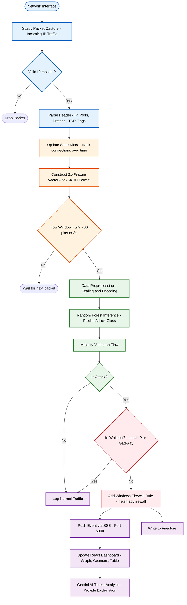

# CyberSentinel: Algorithm Design & System Flow

CyberSentinel operates as a real-time Intrusion Prevention System (IPS) leveraging machine learning to detect and block malicious network traffic. The algorithmic pipeline can be broken down into five distinct phases, spanning from raw packet capture to actionable threat mitigation.

## 1. Packet Capture & Protocol Parsing Algorithm
The foundation of the detection pipeline begins with capturing incoming network packets using Scapy. 
- **Filtering:** The sniffer focuses solely on incoming traffic (`dst == my_ip`) to minimize processing overhead.
- **Protocol Decoding:** Packets that lack an IP layer (such as ARP or broadcast) are immediately discarded. The algorithm parses the headers of TCP, UDP, and ICMP packets to extract raw data: source IP, destination IP, source port, destination port, packet length, TCP flags, and timestamp.
- **Flag Translation:** Raw TCP flags are mapped to standard NSL-KDD string identifiers (e.g., `SF` for normal, `S0` for SYN sent without acknowledgment, `REJ` for rejected).

## 2. Stateful Feature Extraction Algorithm
Raw packet headers are insufficient for robust machine learning classification. The system constructs a 21-dimensional statistical feature vector—matching the NSL-KDD dataset format—by aggregating historical context over a sliding time window (typically 3 seconds or 30 packets).
- **State Dictionaries:** The feature extractor maintains running state dictionaries (e.g., `count_dict`, `srv_count`, `dst_host_count`) across packets to track connection rates, error rates, and host access patterns.
- **Feature Computation:** The algorithm computes intrinsic features (duration, bytes transferred), content features, and traffic features (e.g., fraction of connections going to the same service `same_srv_rate`, or fraction of connections to a service from different hosts `srv_diff_host_rate`).
- **Temporal Aggregation:** By monitoring the rate and characteristics of packets over the last 2 seconds from a source IP, the algorithm successfully distinguishes between a single malformed packet and a coordinated attack (e.g., a port scan or DDoS).

## 3. Machine Learning Classification (Random Forest)
Once the 21-feature vector is synthesized, it is passed to the ML inference engine.
- **Preprocessing:** The raw feature values undergo standard scaling and categorical transformation via a pre-trained `scikit-learn` pipeline.
- **Random Forest Inference:** The transformed vector is fed into a Random Forest Classifier trained on 20 attack categories. The tree ensemble rapidly traverses decision boundaries to output an attack label (e.g., `neptune.`, `portsweep.`, or `normal.`).
- **Flow-level Majority Voting:** To prevent transient false positives, the system aggregates predictions for a "flow" (a sequence of packets from the same source). It applies a majority voting algorithm—if any critical threshold of packets within the flow is classified as an attack, the entire flow is flagged, and the most frequent attack label is assigned.

## 4. Active Defense & Mitigation Algorithm
Upon detecting a malicious flow, the system transitions from passive monitoring to active prevention.
- **Safeguard Verification:** The source IP is cross-referenced against a whitelist (`NEVER_BLOCK_IPS` / `NEVER_BLOCK_PREFIXES`) containing local gateways and trusted cloud subnets.
- **Dynamic Firewall Injection:** If the IP is not whitelisted, the blocker script executes a system-level command (`netsh advfirewall firewall add rule`) to instantly sever the connection at the OS network layer.

## 5. Real-Time Telemetry & Threat Analysis
Post-mitigation, the event metadata must be communicated to the user without polling delays.
- **Server-Sent Events (SSE):** The Python engine dispatches the attack payload over an asynchronous HTTP SSE stream to the React frontend.
- **Persistent Logging & AI Augmentation:** Concurrently, the attack vector is written to a Firestore database. The web interface then leverages the Gemini API to analyze the attack signature and provide plain-English explanations and remediation steps to the security analyst.

---

## Process Flowchart

Below is a flowchart illustrating the step-by-step execution path of an incoming packet through the system.

