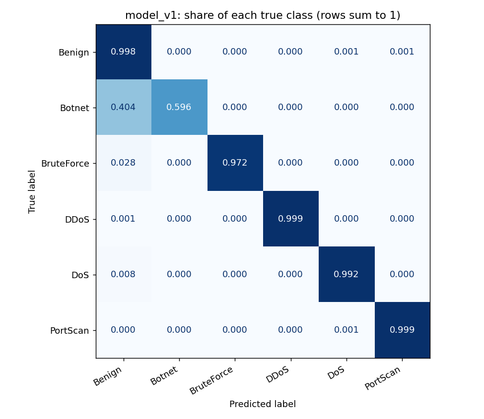

# Model report: model_v1

Generated by `train_cicids2017.ipynb` on 2026-10-12. Do not edit by hand; rerun the notebook.

## Summary

- **Algorithm:** Random Forest, 100 trees, max depth 20, inside one scikit-learn pipeline
- **Dataset:** CICIDS2017, 2,830,743 raw flows
- **Features:** 19 (see `features.json`)
- **Classes:** Benign, Botnet, BruteForce, DDoS, DoS, PortScan
- **Test accuracy:** 0.9956
- **Test macro F1:** 0.9472
- **Training time:** 33 s
- **Model file:** 7.8 MB
- **Environment:** Python 3.10.18, scikit-learn 1.7.2, seed 42

## Data

| Step | Rows |
|---|---|
| raw rows | 2,830,743 |
| after dropping excluded labels | 2,828,516 |
| after removing Infinity/NaN/negative duration | 2,825,534 |
| after removing exact duplicates | 2,476,428 |

Labels dropped: Infiltration (36), Web Attack - Brute Force (1,507), Web Attack - XSS (652), Web Attack - Sql Injection (21), Heartbleed (11).

Benign was downsampled to 500,000 flows; all attack flows were kept.

| class | train | test |
|---|---|---|
| Benign | 400000 | 100000 |
| Botnet | 1559 | 389 |
| BruteForce | 7318 | 1830 |
| DDoS | 102409 | 25602 |
| DoS | 154874 | 38719 |
| PortScan | 72555 | 18139 |

## Results on the test set

| class | precision | recall | f1-score | support |
|---|---|---|---|---|
| Benign | 0.9945 | 0.9976 | 0.9961 | 100000 |
| Botnet | 0.8788 | 0.5964 | 0.7106 | 389 |
| BruteForce | 0.9989 | 0.9721 | 0.9853 | 1830 |
| DDoS | 0.9994 | 0.9988 | 0.9991 | 25602 |
| DoS | 0.9962 | 0.9920 | 0.9941 | 38719 |
| PortScan | 0.9966 | 0.9989 | 0.9978 | 18139 |

Confusion matrix (rows are the true class, columns the predicted class):

|  | pred Benign | pred Botnet | pred BruteForce | pred DDoS | pred DoS | pred PortScan |
|---|---|---|---|---|---|---|
| true Benign | 99762 | 32 | 2 | 14 | 131 | 59 |
| true Botnet | 157 | 232 | 0 | 0 | 0 | 0 |
| true BruteForce | 51 | 0 | 1779 | 0 | 0 | 0 |
| true DDoS | 29 | 0 | 0 | 25572 | 1 | 0 |
| true DoS | 304 | 0 | 0 | 2 | 38411 | 2 |
| true PortScan | 7 | 0 | 0 | 0 | 13 | 18119 |

## Confidence threshold for automatic blocking

| threshold | attack flows blocked | benign flows blocked by mistake | benign mistakes per 100,000 flows |
|---|---|---|---|
| 0.50 | 99.35% | 0.236% | 236 |
| 0.70 | 99.14% | 0.150% | 150 |
| 0.80 | 98.95% | 0.111% | 111 |
| 0.90 | 98.66% | 0.083% | 83 |
| 0.95 | 98.29% | 0.068% | 68 |
| 0.99 | 94.82% | 0.046% | 46 |

## Experiment: feature groups

| experiment | n_features | macro_f1 | Botnet P | Botnet R | BruteForce R | Benign R |
|---|---|---|---|---|---|---|
| core | 19 | 0.9475 | 0.8792 | 0.5990 | 0.9721 | 0.9976 |
| core + flags | 24 | 0.9476 | 0.8821 | 0.5964 | 0.9721 | 0.9979 |
| core + window | 21 | 0.9827 | 0.9031 | 0.9100 | 0.9929 | 0.9987 |
| core + port | 20 | 0.9583 | 0.8517 | 0.6941 | 0.9962 | 0.9977 |
| core + window + port | 22 | 0.9856 | 0.9156 | 0.9203 | 0.9995 | 0.9989 |
| all candidates | 27 | 0.9848 | 0.9171 | 0.9100 | 0.9995 | 0.9989 |

`core` was selected. Flag counts add nothing and cannot be reproduced live. Window sizes and destination port score higher but do so by recognising the lab's attacker machines and service ports.

## Experiment: class imbalance

| experiment | n_features | macro_f1 | Botnet P | Botnet R | BruteForce R | Benign R |
|---|---|---|---|---|---|---|
| no weighting | 19 | 0.9475 | 0.8792 | 0.5990 | 0.9721 | 0.9976 |
| class_weight=balanced | 19 | 0.8565 | 0.1247 | 0.9666 | 0.9738 | 0.9689 |
| class_weight=balanced_subsample | 19 | 0.8565 | 0.1265 | 0.9717 | 0.9743 | 0.9692 |
| oversample rare classes to 30k | 19 | 0.8861 | 0.2187 | 0.8715 | 0.9743 | 0.9858 |

No weighting was selected. Weighting raises Botnet recall but its precision collapses.

## Feature importance

| feature | importance |
|---|---|
| Packet Length Std | 0.1074 |
| Bwd Packet Length Mean | 0.0992 |
| Total Length of Fwd Packets | 0.0987 |
| Packet Length Mean | 0.0916 |
| Bwd Packet Length Max | 0.0852 |
| Fwd Packet Length Max | 0.0848 |
| Total Length of Bwd Packets | 0.0738 |
| Fwd Packet Length Mean | 0.0676 |
| Total Fwd Packets | 0.0449 |
| Flow Packets/s | 0.0396 |
| Flow IAT Std | 0.0395 |
| Flow IAT Max | 0.0363 |
| Flow Duration | 0.0283 |
| Flow IAT Mean | 0.0270 |
| Fwd IAT Mean | 0.0268 |
| Flow Bytes/s | 0.0222 |
| Total Backward Packets | 0.0190 |
| Bwd IAT Mean | 0.0050 |
| Down/Up Ratio | 0.0031 |

## Known limitations

- **Botnet is the weak class** (recall 0.60). Its flows look like ordinary web traffic at this feature level.
- **Web attacks, Infiltration and Heartbleed are not detected.** They were excluded for lack of samples.
- **These scores are for this dataset.** The test set comes from the same lab network as the training set, so results on a different network will be lower. The engine therefore also uses rate-based rules and a confidence threshold.
- **Live features must match.** The engine has to compute each feature the way the dataset does (see `features.json`).
